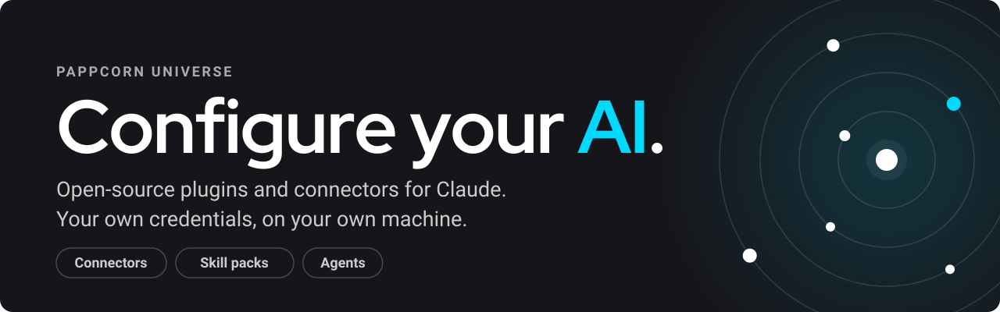

<a href="https://pappcorn.ai/universe">
  
</a>

<div align="center">

[](LICENSE)
[](https://github.com/pappcorn/universe/actions/workflows/ci.yml)
[](https://nodejs.org)
[](https://modelcontextprotocol.io)

**Catalog home: [pappcorn.ai/universe](https://pappcorn.ai/universe)** ·
**[Talk to Cris](https://pappcorn.ai/?de=universe-readme)** ·
**[Contributing](CONTRIBUTING.md)**

</div>

**PappCorn Universe is `pappcorn-plugins`, PappCorn's plugin catalog for
Claude.** Connectors for your email, your spreadsheets and your WhatsApp that
run on your own credentials, skill packs that help you configure your AI for
your own work, and a licensed product team of agents. Everything except the
product team is free and MIT, and you can read every line before you trust it.

```bash
/plugin marketplace add pappcorn/universe
/plugin install gmail-mcp@pappcorn-plugins
```

## The catalog

<table>
<tr>
<td width="50%" valign="top">

### ✉️ [gmail-mcp](packages/gmail-mcp)

 **Connector**

Read, search, triage, draft and **send** email, with attachments, from your
own Gmail account. It confirms before sending and never deletes.

</td>
<td width="50%" valign="top">

### 📊 [gsheets-mcp](packages/gsheets-mcp)

 **Connector**

Inspect, search and **edit** the Google Sheets shared with you, by range,
without loading the whole file into the conversation.

</td>
</tr>
<tr>
<td width="50%" valign="top">

### 💬 [whatsapp-mcp](packages/whatsapp-mcp)

 **Connector**

Send messages and approved templates from your own business number, through
Meta's official WhatsApp Cloud API.

</td>
<td width="50%" valign="top">

### 🌿 [best-practices-git](packages/best-practices-git)

 **Skill pack**

How a team that works with agents commits (`/commit`), opens pull requests
(`/git-pr`) and runs parallel branches (`/worktree`).

</td>
</tr>
<tr>
<td width="50%" valign="top">

### 🧭 [cris-asiste](packages/cris-asiste)

 **Skill pack** · in Spanish

Configure your own AI: build a focused agent, teach Claude a task, set up a
personal assistant. Also available [as kits for the Claude chat](#cris-asiste-kits-for-the-claude-chat).

</td>
<td width="50%" valign="top">

### 🏭 product-team

 **Agents**

PappCorn's six-agent [INSPIRED](https://www.svpg.com/books/inspired-how-to-create-tech-products-customers-love-2nd-edition/)
product team plus its dev-loop skills. [Request access](mailto:cris@pappcorn.com).

</td>
</tr>
<tr>
<td width="50%" valign="top">

### 💵 [finanzas-usa](packages/finanzas-usa)

 **Agents** · in Spanish

Two advisors for money in the United States: **Indexandro** (an IPS, a boring
indexed core and a monthly review from your Interactive Brokers statements) and
**Tributina** (personal and small-business taxes, ready for your CPA). They
propose; they never trade or file. Also usable [as Claude Projects](packages/finanzas-usa#en-la-app-de-claude-sin-terminal-proyectos-y-una-carpeta).

</td>
<td width="50%" valign="top">
</td>
</tr>
</table>

**Connectors** are open source and bring-your-own-credentials. Each one runs
as a local process on your machine, signs in with your own Google or Meta
credentials, and talks straight to Google or Meta with no server in between.
They are standard MCP servers, so they work in any MCP client, not only Claude.

**Skill packs** need no credentials and no server: they are skills that encode
a way of working. `best-practices-git` is the first of a `best-practices-*`
family, one plugin per practice a team otherwise learns the hard way.

**Agent packs** are free agents with a narrow job, a memory in plain files you
own, and hard limits written into each agent. `finanzas-usa` is the first.

**Licensed plugins** keep their source in a private repository. The catalog
entry points at that repo, and **read access to the repo is the license**:
with access granted, installation just works; without it, the install fails,
which is expected, not broken. To request access to `product-team`, write to
[cris@pappcorn.com](mailto:cris@pappcorn.com).

## Quick start

**1. Add the marketplace** (once):

```bash
/plugin marketplace add pappcorn/universe
```

**2. Install what you need:**

```bash
/plugin install gmail-mcp@pappcorn-plugins
/plugin install gsheets-mcp@pappcorn-plugins
/plugin install whatsapp-mcp@pappcorn-plugins
/plugin install best-practices-git@pappcorn-plugins
/plugin install cris-asiste@pappcorn-plugins
/plugin install finanzas-usa@pappcorn-plugins
```

The plugin asks for your credentials at install time and keeps them in your
operating system's keychain. Each connector needs a one-time account setup
first:

| Connector        | Setup guide                                                                                                   | Time    | Notes                                         |
| ---------------- | ------------------------------------------------------------------------------------------------------------- | ------- | --------------------------------------------- |
| ✉️ Gmail         | [Connect your own Gmail account](docs/setup-google-cloud.md) · [screenshot walkthrough](docs/how-to-gmail.md) | ~15 min |                                               |
| 📊 Google Sheets | [Connect your own Google Sheets account](docs/setup-google-sheets.md)                                         | ~10 min | Its own APIs and token, separate from Gmail's |
| 💬 WhatsApp      | [Connect your own WhatsApp number](docs/setup-meta-whatsapp.md)                                               |         | Free test number, no line to buy              |

The skill and agent packs need none of that. `best-practices-git` drives the
`git` and `gh` already on your machine, `cris-asiste` only writes the files you
agree to, where you agree to, and `finanzas-usa` works from the statements you
download yourself. Prefer wiring it by hand, or not using plugins at all?
See [install.md](docs/install.md).

### Not on Claude?

The connectors are standard [MCP](https://modelcontextprotocol.io) servers over
stdio, and nothing in them is Claude-specific. Codex CLI, Gemini CLI, Cursor,
or any other MCP-capable agent can run them: clone the repo and point your
client at the self-contained bundle (`node packages/gmail-mcp/server/mcp.cjs`,
no build step, no dependencies). See
[install.md → any MCP client](docs/install.md#path-c--any-mcp-client).

## cris-asiste kits for the Claude chat

Plugins don't run in the Claude chat, so each `cris-asiste` skill also ships as
an uploadable `.zip`. The skills talk to you in Spanish.

<table>
<tr>
<td width="33%" valign="top">

**`/crear-agente`**

A small helper with one clear job, one source of information and clear limits.

[⬇ Download .zip](https://pappcorn.github.io/universe/kits/crear-agente.zip) · [Guide](packages/cris-asiste/skills/crear-agente/GUIA.md)

</td>
<td width="33%" valign="top">

**`/crear-skill`**

Teach your Claude a task you repeat, so you stop explaining it every time.

[⬇ Download .zip](https://pappcorn.github.io/universe/kits/crear-skill.zip) · [Guide](packages/cris-asiste/skills/crear-skill/GUIA.md)

</td>
<td width="33%" valign="top">

**`/crear-asistente`**

Your own personal assistant, with your goals and a memory in a folder you own.
Needs Claude Code.

[⬇ Download .zip](https://pappcorn.github.io/universe/kits/crear-asistente.zip) · [Guide](packages/cris-asiste/skills/crear-asistente/GUIA.md)

</td>
</tr>
</table>

In the Claude chat, upload each `.zip` in **Customize → Skills → + → Upload a
skill** (it needs **Code execution and file creation** turned on). In Claude
Code, `/plugin install cris-asiste@pappcorn-plugins` installs all three at
once.

## The one rule: your credentials are yours

Every connector here is **bring your own app**. You create your own Google or
Meta application, authorize your own account, and the credential never leaves
your machine. We host nothing, proxy nothing, and there is no PappCorn account
anywhere near your mailbox.

This is more work than clicking "connect". It is also the only version where
the honest answer to _"who else can read my email?"_ is **nobody**. And because
you run your own app for your own account, you never cross the thresholds that
trigger expensive vendor security reviews. Those exist to protect other
people's data from a shared app, and with one user there is no shared app.

### Why we write our own connectors

Installing a connector means handing an agent real power over a real account.
An unmaintained third-party server is both a supply-chain risk and a
prompt-injection surface. We build and maintain these ourselves so the tool
surface stays small, auditable and deliberate, and so you can read every line
before you trust it.

### What they will not do

- **Nothing autonomous.** They act when you ask. Nothing watches your inbox and
  replies on its own.
- **Sending always confirms first**: recipient, subject, full body.
- **Gmail never deletes mail.** It labels and archives, and that is all.

## Who it is for

- **People who use Claude** and want it to act on their own accounts (send the
  email, edit the sheet, message the customer) without handing their
  credentials to anyone.
- **Teams that work with agents** and want shared, written-down ways of
  working, packaged as skills.
- **Developers on any MCP client.** The connectors are standard MCP servers.

If you would rather have someone walk you through it, talk to **Cris** at
[pappcorn.ai](https://pappcorn.ai/?de=universe-readme). Cris is PappCorn's AI
agent, the friend who knows AI and helps you configure it for your own work.
Plans live there too.

## Repository layout

```
packages/    connectors, skill packs and libraries (each installable on its own)
apps/        deployable applications
site/        the public front door, GitHub Pages, in Spanish (see site/README.md)
tools/       operator scripts
docs/        setup guides
```

The masterclass kit ("Tu Ventaja con IA", in Spanish) lives on its own page:
[pappcorn.github.io/universe/masterclass.html](https://pappcorn.github.io/universe/masterclass.html).

It is an Nx monorepo on Node 20+:

```bash
npm install
npx nx run-many -t build
```

## Contributing

Contributions are very welcome. Start with [CONTRIBUTING.md](CONTRIBUTING.md),
especially [the rules that aren't negotiable](CONTRIBUTING.md#the-rules-that-arent-negotiable).

These connectors are also used in production at PappCorn, so improvements made
here get pulled back into our own stack. Fixing something for yourself
probably fixes it for us too.

Maintainers: how each product in the catalog is versioned, released, verified
and reviewed is in [docs/maintaining.md](docs/maintaining.md).

## Security

Found a vulnerability? Please don't open a public issue. See
[Reporting a security issue](CONTRIBUTING.md#reporting-a-security-issue).

## License

[MIT](LICENSE). Do what you like with it.

<div align="center">
<sub>Built by <a href="https://pappcorn.com">PappCorn</a> 🍿 · Talk to Cris at <a href="https://pappcorn.ai/?de=universe-readme">pappcorn.ai</a></sub>
</div>
